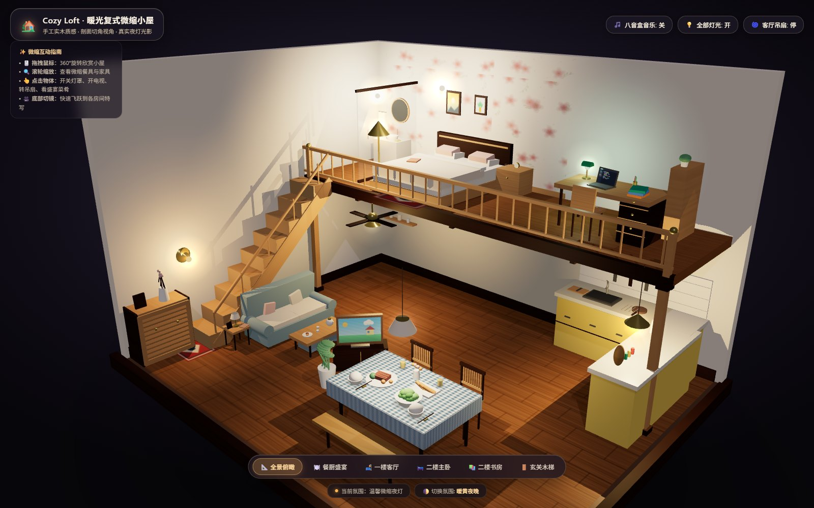
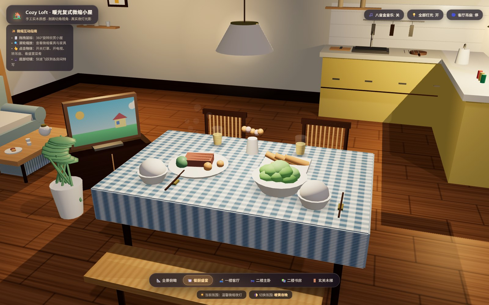
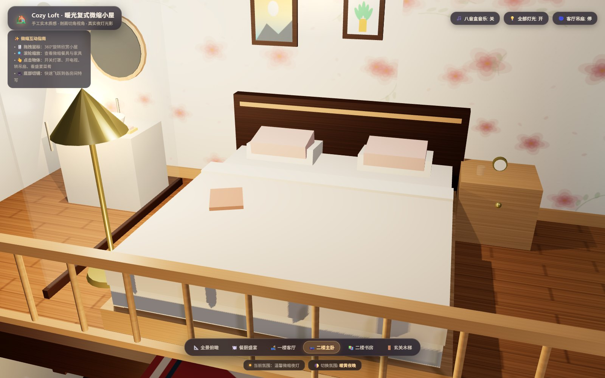
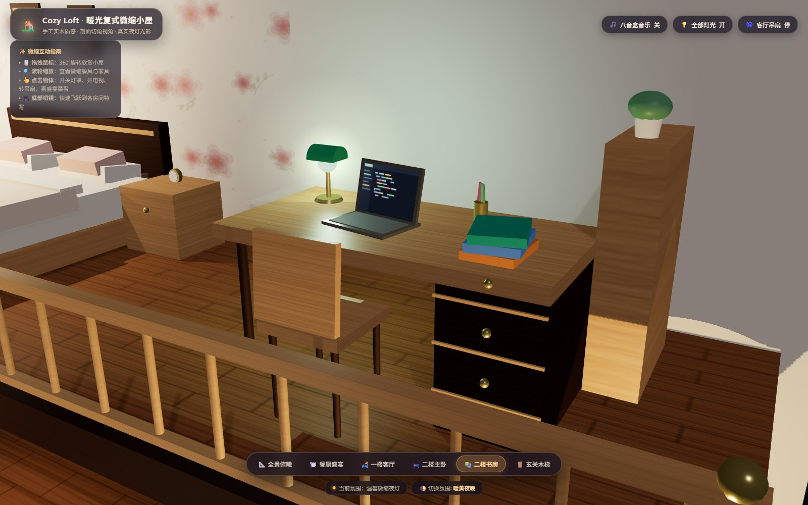

# 🏡 Cozy Loft · 暖光复式微缩小屋

> 一个用纯 HTML + Three.js 手工搭建的 **3D 微缩双层 Loft 小屋（Dollhouse Diorama）**。
> 单文件、零外部依赖、双击即开 —— 有暖黄的小灯、摆满菜的餐桌、会转的吊扇，还有一台正在放动画的小电视。



---

## ✨ 这是什么

参考真实的手工微缩模型（Dollhouse / 书立小屋）照片，用代码把它一块木头、一只杯子地"拼"了出来。

没有用任何 3D 建模软件导出的模型文件 —— **房子里的每一件家具、每一块木纹、每一朵壁纸上的小花，都是运行时用 JavaScript 生成几何体 + Canvas 实时绘制贴图得到的**。

整个项目最终只有 **一个 `index.html`**（含内联的 Three.js 核心），打开就能玩。

---

## 🚀 在线体验

👉 **[点这里直接打开](https://dusash.github.io/cozy-loft-dollhouse/)**（GitHub Pages 部署后可用）

如果 Pages 还没生效，也可以下载 `index.html` 后直接双击，效果完全一样。

---

## 🖼️ 更多预览

| 🍽️ 餐厨盛宴 | 🛏️ 二楼主卧 |
| :---: | :---: |
|  |  |

| 📚 二楼书房 | 🌙 全景 |
| :---: | :---: |
|  |  |

---

## 🎮 可以怎么玩

### 基础操作
| 操作 | 效果 |
| :--- | :--- |
| **拖拽左键** | 360° 环绕旋转，从任意角度看小屋 |
| **滚动滚轮** | 推近 / 拉远，凑近看餐盘里的炸虾 |
| **拖拽右键** | 平移视角 |

### 点击互动
把鼠标移到可以点的东西上，会浮出一张小名片告诉你这是什么。

- 🏮 **各房间的小灯** —— 玄关壁灯、吧台吊灯、餐桌吊灯、客厅吊扇灯、卧室郁金香落地灯、书房绿罩台灯……每盏都能独立开关
- 📺 **客厅电视** —— 点击开 / 关机，开机时会播放像素风的蓝天白云小动画
- 🌀 **客厅吊扇** —— 点击开 / 停，叶片会带惯性缓慢加速、缓慢停下
- 🍱 **餐桌大餐** —— 点击自动飞到餐桌特写机位
- 🗄️ **玄关鞋柜**、**茶几茶具** —— 点击跳转对应区域

### 一键机位
底部工具栏有 6 个机位，点击后镜头会以缓动曲线平滑飞过去：

`📐 全景俯瞰` · `🍽️ 餐厨盛宴` · `🛋️ 一楼客厅` · `🛏️ 二楼主卧` · `📚 二楼书房` · `🚪 玄关木梯`

### 氛围切换
点右下角的 `🌓 切换氛围`，在三种灯光氛围间循环：

- **暖黄夜晚** —— 推荐，所有小灯亮起，最接近原版微缩模型的质感
- **清新晨光** —— 冷白自然光，像清晨拉开窗帘
- **晚霞黄昏** —— 橘红斜阳，适合慢慢看

### 八音盒
右上角 `🎵 八音盒音乐`，用 Web Audio API **实时合成**的空灵八音盒旋律（没有任何音频文件，全部是代码算出来的波形）。

---

## 🏠 房子里都有什么

### 一楼

**玄关**
- 贴左墙的实木直跑楼梯（9 级踏步 + 斜封边 + 木扶手 + 立柱）
- 百叶门小鞋柜，柜顶插一枝粉色桃花、一个小相框
- 门口吸水地垫、复古黄铜壁灯
- 墙面挂画 + 木搁板 + 三个小陶罐

**客厅**
- 灰蓝布艺双人沙发（圆扶手、米白软坐垫、粉白抱枕）
- 实木长茶几：白瓷茶壶、两只小茶杯、点心盘和曲奇
- 电视柜 + 复古液晶电视（屏幕有动态动画）
- 落地绿植、碎花小软凳、沙发边几（小台灯 + 摊开的书）
- 四叶古铜木吊扇（可转动）

**餐厨区**
- L 型明黄色橱柜（银色拉手、门缝线）+ 米白石英石台面
- 不锈钢水槽 + 鹅颈水龙头、黑色煎锅、砧板菜刀、调味罐、沥水架
- 白色防溅瓷砖墙 + 原木托板 + 两个陶罐
- 挂墙厨具杆（锅铲汤勺）、侧边悬挂的镂空编织网兜
- 蓝白格纹桌布大餐桌：香煎牛排（带焦痕）、天妇罗炸虾、蓬松沙拉碗、两碗米饭、筷子、果汁杯、桌心小花瓶
- **菜品上方有袅袅升起的蒸汽粒子**
- 亚麻灯罩吊灯、藤编长凳、两把镂空靠背木椅

### 二楼

**主卧**
- 原木双人床：深色床头板、厚床垫、折叠棉被、粉白双层枕头、床侧摊开的睡前书
- 床头柜 + 复古小闹钟 + 水杯
- **郁金香花苞落地灯**（金色花苞灯罩 + 暖光内芯）
- 两幅风景挂画、床尾小地毯
- 满墙碎花壁纸（水彩感，花枝随机散布）

**书房**
- 转角实木书桌 + 三层抽屉柜（黄铜球拉手）
- 打开的笔记本电脑（屏幕是深色代码编辑器）
- 经典翡翠绿罩银行台灯（会投出绿色光斑）
- 笔筒彩笔、堆叠书本、办公椅、靠墙高柜 + 绿萝

**卫浴**
- 磨砂玻璃隔断推拉门（黑框）
- 白色瓷质洗手台、台盆龙头、椭圆木框梳妆镜
- 毛巾、香皂盒、藤编洗衣篮

### 建筑本体
- 实木底座托盘 + 外框包边
- 二楼挑空楼板（L 形剖面：前部完全挑空，所以俯视能看到一楼全貌）
- 承重木立柱（带柱头柱脚）、楼板前沿封边梁与托梁
- 二楼实木护栏（扶手 + 密集立柱 + 黄铜球头柱头）
- 全屋木地板（程序化木纹 + 板缝交错拼接）
- 底座下方柔和接触阴影（让它"坐"在桌面上）

---

## 🛠️ 技术实现

| 技术点 | 说明 |
| :--- | :--- |
| **Three.js r128** | 核心渲染，**已内联进 HTML**，不依赖任何 CDN |
| **色彩空间** | `outputEncoding = sRGBEncoding` + `ACESFilmicToneMapping`，冷灰和塑料感就是这么被干掉的 |
| **程序化贴图** | 全部用 Canvas 2D 实时绘制：木纹与板缝、蓝白格纹、碎花壁纸、藤编网纹、几何地毯、风景挂画、代码编辑器界面、电视动画 |
| **灯光系统** | 8 盏独立 `PointLight`（可单独开关）+ Sprite 加法混合光晕 + 低 decay 形成柔和"光池" |
| **阴影** | `PCFSoftShadowMap` + 手写"接触阴影"贴片，解决小物件悬浮感 |
| **交互拾取** | `Raycaster` + 递归向上查找 `userData`，支持悬停名片与点击回调 |
| **相机运镜** | 手写 ease-in-out-cubic 插值，不依赖 tween 库 |
| **音频** | Web Audio API 双振荡器（正弦 + 非谐三角泛音）模拟八音盒金属簧片 |
| **自适应** | 窗口尺寸变化自动更新投影矩阵与渲染尺寸 |

### 为什么要把 Three.js 内联？

因为用了 CDN 就可能在网络受限时白屏。内联之后整个页面 **700KB 左右、零请求、完全离线可用**，
从 U 盘拷走或者直接双击都能跑。

---

## 📂 文件结构

```
cozy-loft-dollhouse/
├── index.html            # 全部内容（HTML + CSS + 内联 Three.js + 建模与交互代码）
├── README.md
└── screenshots/          # README 使用的预览图
    ├── hero.jpg
    ├── dining.jpg
    ├── bedroom.jpg
    └── study.jpg
```

---

## 💻 本地运行

**方式一：直接双击**
下载 `index.html`，双击用浏览器打开就行。

**方式二：起一个本地服务**（如果想在手机上同局域网访问）

```bash
# Python
python -m http.server 8000

# 或 Node
npx serve .
```

然后访问 `http://localhost:8000`。

> 建议用 Chrome / Edge / Safari 等支持 WebGL 的现代浏览器。

---

## 🎨 想自己改改？

打开 `index.html`，几个好找的入口：

| 想改什么 | 去哪找 |
| :--- | :--- |
| 房间布局 / 加家具 | `const HouseBuilder = { ... }` 里的 `buildLivingRoom()`、`buildKitchenAndDining()` 等 |
| 贴图配色 | `const TextureGenerator = { ... }`，比如 `createTablecloth()` 改桌布颜色 |
| 材质 | `const Materials = { ... }` |
| 灯光位置与色温 | `Lighting.init()` 里的 `this.createLamp('kitchen', new THREE.Vector3(...), '#ffb04a', ...)` |
| 相机机位 | `CameraManager.presets` |
| 八音盒旋律 | `MusicBoxAudio` 里的 `this.melody` 数组 |

坐标系约定：`x` 左右（左负右正）、`y` 高度（一楼地板 `y≈0`，二楼楼板 `y≈4.34`）、`z` 前后（后墙 `z≈-5.5`）。

---

## 📝 说明

- 所有家具都是低多边形程序化建模，**追求的是"微缩模型的手工感"而不是照片级写实**。
- 三角形数量控制在浏览器能轻松跑 60fps 的范围内。
- 只用了 Three.js 一个库（MIT License），其余全部自写。

---

## 📄 License

MIT —— 随便拿去改、拿去用。

如果这个小屋让你想起小时候趴在橱窗前看模型的那个下午，那就够了。🏡
